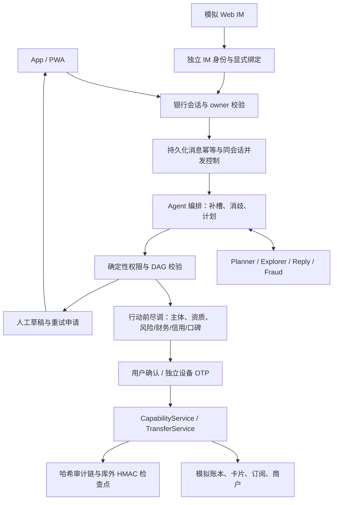

# 行止（ActSure）系统架构

## 体验入口

代码与运行入口（内部项目名 AgentBank）：[AgentBank 仓库](https://github.com/Weichenleeeee123/AgentBank)。首次体验请按 [本地运行说明](LOCAL-RELEASE.md) 安装依赖并启动服务，再在本机打开 [银行 App](http://127.0.0.1:8001/app/)。该地址是启动后的本机地址，不是公网演示站点。

选择演示账户 `user_001`，依次输入“查余额”“给房东转账”“20 元”，核对确认卡后确认，再查询余额和流水。可以直接观察查询、追问、确认和账本结果。设备强验证、模拟 IM、生日计划和评测面板的操作步骤见 [评委体验指南](LOCAL-REVIEW-GUIDE.md)。

## 系统分层

行止把模型/自然语言层放在执行内核之外。Agent 编排器位于 `backend/agentbank/agent/`，负责意图、槽位、消歧、能力路由和确认卡；`CapabilityService` 位于 `backend/agentbank/bank/capabilities_full.py`，负责身份、幂等、业务状态和审计；转账的最终账本提交由 `TransferService` 完成。

## 一次对话

1. 在线结构化 LLM planner 产生能力、槽位和任务关系，服务端校验 schema、当前话语依据和参数来源；`IntentParser` 是无 provider 时的有限规则降级。关键槽位缺失时澄清。
2. `CapabilityService.execute` 先查幂等键，再检查熔断和红色 MFA 要求。
3. 写操作生成 `CapabilityRecord`；转账写操作还生成业务计划和授权凭证（receipt）。
4. 用户完成所需确认或模拟设备验证码验证后，业务服务复核授权与当前状态，再提交操作。转账由 `TransferService.confirm/verify` 处理。
5. 每个结果包含业务状态和审计事件名，事实回复用片段检查器校验。

对公转账在 `TransferService` 准备及确认时检查收款主体；理财申购在 `CapabilityService` 的准备、确认和执行路径检查产品发行主体。报告包含模拟登记状态和编号、资质状态和编号、风险/财务/信用/口碑四类具体样例、各条证据的样本编号与更新时间、核验缺口及建议问题。主体无法匹配或模拟资质目录未命中时，不创建可执行授权；通过时，完整摘要加入确认展示并纳入展示哈希；拒绝和通过事件写入审计链。当前样本为源码中可复现的合成数据，不是外部实时调查服务或真实监管结果。

## 跨场景计划

生日计划由 `BusinessPlanService` 生成六节点 DAG：事件读取、鲜花报价、蛋糕报价、资金预留、鲜花订单、蛋糕订单。`PlanValidator` 检查工具白名单、拓扑顺序、来源和补偿声明；`GET /v1/plans/{id}/graph` 返回节点状态、授权和补偿信息。

X05 是独立的盗刷处置流程：先确认并冻结卡片，再通过设备强验证办理挂失。挂失验证失败时，卡片继续保持冻结。生日订单的失败补偿由恢复机制处理，不属于 X05。

## 渠道

- `/v1/conversations/{id}/messages`：App/PWA 对话入口；
- `/v1/im/webim/events`：签名和事件去重后的 Web IM 入口；
- `/v1/im/webim/sessions`、`/bind`、`/messages`、`/callbacks`：浏览器模拟 IM 网关。签名密钥保留在服务端，IM token 只存哈希，银行绑定需有效银行会话；
- `/v1/im/feishu/events`：签名、事件去重和 Agent 路由的飞书适配器；
- `/app/`：静态 PWA 壳，调用同一套 API；
- `/device/v1/inbox`：模拟手机 OTP 入口。

## 失败与重复请求

新消息使用独立 message_id，同 ID 同参数重试返回持久结果，改参数拒绝。同一用户同一会话处理中的另一条消息返回 `CONVERSATION_BUSY`，避免补槽状态交错。未知结果不重新派发潜在资金操作，用户先查账或人工核实；明确未开始的拒绝要求稍后发新消息。消息执行不包住远程模型调用的大事务，已消耗的模型预算独立持久化。

会话执行期间持有操作系统文件锁，进程退出时自动释放。下一条请求取得锁后，将遗留 processing 消息持久标为 unknown 并写审计，同一对话可以接收新消息；重试旧消息仍返回 MESSAGE_OUTCOME_UNKNOWN，不自动重发可能已经提交的资金操作。锁文件位于 SQLite 文件旁的 `.message-locks` 目录，仅含哈希文件名与占位字节，不删除或替换。多个本地 worker 必须共享数据库及该目录，底层文件系统必须支持 OS 锁；滚动混用旧版未加锁 worker 不受支持，升级时先停止旧 worker。此机制不宣称支持分布式数据库部署。

PWA 仅缓存静态壳，账户 API `no-store` 且不进入 service worker 缓存。坐席使用独立 token，其建议和重试申请只通知用户，不能代用户执行、确认或消耗旧授权。部署边界和本地复现见 [LOCAL-RELEASE.md](LOCAL-RELEASE.md)。

## 实现说明与资金边界

前端采用静态 HTML / JavaScript 模块与 PWA，不依赖 React 构建。

任务修订由结构化 task_action 与当前话语依据共同判断；授权凭证绑定对象、金额、任务版本和确认卡哈希，修订时原子作废旧授权。确认、设备验证和 DAG 派发共用提交前动态策略复核，不能依赖准备时的权限等级。AA 付款绑定应付份额及付款人与发起人的模拟账户，在同一事务内借记付款人、贷记发起人并累计日支付额。

生日计划完成安排后是 waiting_trigger；暂停阻止到期派发，取消撤销未来授权并释放剩余预留；调度结果回填父节点，实际完成后才 succeeded。已执行部分不被取消操作伪装成退款，部分失败显示 partially_completed 并可查证/取消未执行部分。

风险问卷使用版本化十题，保存答案、分数、等级、测评日及一年有效期。演示数据包含连续 24 月的合成流水，不会重置已有数据库。

可直接打开的静态架构图：[architecture.svg](architecture.svg)。
