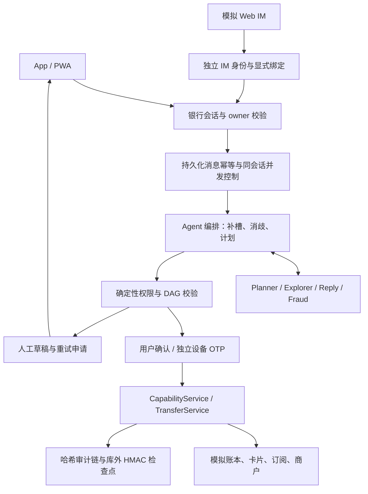

# AgentBank 系统架构

## 边界

AgentBank 把模型/自然语言层放在执行内核之外。当前可运行的 Agent 编排器位于 `backend/agentbank/agent/`，负责意图、槽位、消歧、能力路由和确认卡；`CapabilityService` 位于 `backend/agentbank/bank/capabilities_full.py`，负责身份、幂等、业务状态和审计；M1 转账的最终账本提交仍由 `TransferService` 完成。

## 一次对话

1. `IntentParser` 只产生结构化槽位；金额、收款人和产品缺失时返回澄清。
2. `CapabilityService.execute` 先查幂等键，再检查熔断和红色 MFA 要求。
3. 写操作生成 `CapabilityRecord`；转账写操作还生成 M1 plan/receipt。
4. 用户确认或模拟手机 OTP 后，才调用 `TransferService.confirm/verify`。
5. 每个结果包含业务状态和审计事件名，事实回复用片段检查器校验。

## 计划

生日计划由 `BusinessPlanService` 生成四节点 DAG：事件读取、资金预留、鲜花订单、蛋糕订单。`PlanValidator` 检查工具白名单、拓扑顺序、来源和补偿声明；`GET /v1/plans/{id}/graph` 返回节点状态、授权和补偿信息。

## 渠道

- `/v1/conversations/{id}/messages`：App/PWA 对话入口；
- `/v1/im/webim/events`：签名和事件去重后的 Web IM 入口；
- `/v1/im/webim/sessions`、`/bind`、`/messages`、`/callbacks`：浏览器模拟 IM 网关。签名密钥保留在服务端，IM token 只存哈希，银行绑定需有效银行会话；
- `/v1/im/feishu/events`：签名、事件去重和 Agent 路由的飞书适配器；
- `/app/`：静态 PWA 壳，调用同一套 API；
- `device/v1/inbox`：模拟手机 OTP 入口。

## 失败与重复请求

新消息使用独立 message_id，同 ID 同参数重试返回持久结果，改参数拒绝。同一用户同一会话处理中的另一条消息返回 `CONVERSATION_BUSY`，避免补槽状态交错。未知结果不重新派发潜在资金操作，用户先查账或人工核实；明确未开始的拒绝要求稍后发新消息。消息执行不包住远程模型调用的大事务，已消耗的模型预算独立持久化。

会话执行期间持有操作系统文件锁，进程退出时自动释放。下一条请求取得锁后，将遗留 processing 消息持久标为 unknown 并写审计，同一对话可以接收新消息；重试旧消息仍返回 MESSAGE_OUTCOME_UNKNOWN，不自动重发可能已经提交的资金操作。锁文件位于 SQLite 文件旁的 `.message-locks` 目录，仅含哈希文件名与占位字节，不删除或替换。多个本地 worker 必须共享数据库及该目录，底层文件系统必须支持 OS 锁；滚动混用旧版未加锁 worker 不受支持，升级时先停止旧 worker。此机制不宣称支持分布式数据库部署。

PWA 仅缓存静态壳，账户 API `no-store` 且不进入 service worker 缓存。坐席使用独立 token，其建议和重试申请只通知用户，不能代用户执行、确认或消耗旧授权。部署边界和本地复现见 [LOCAL-RELEASE.md](LOCAL-RELEASE.md)。
